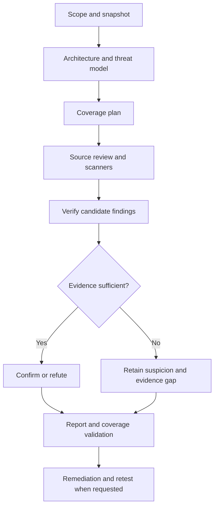

<div align="center">

# 🛡️ Software Security Audit

**Whole-project security reviews for Claude Code — with evidence, verified findings and explicit coverage.**

[](https://github.com/ptrkdev90/security-audit-kit/actions/workflows/validate.yml)
[](LICENSE)


Architecture · Code · Dependencies · Configuration · CI/CD · Compliance evidence

[Quick start](#-quick-start) · [Updates](#-updates-and-latest-version) · [Workflow](#-audit-workflow) · [Coverage](#-review-coverage) · [SOC 2](#-soc-2-and-compliance-readiness) · [Development](#-development-and-validation)

</div>

---

## 🔍 What this toolkit does

Turn a broad “audit this project” request into an inspectable review: establish the
scope, map trust boundaries, examine relevant security domains, triage scanner results,
verify candidates and document what remains untested.

| Capability | What you get |
|---|---|
| **Whole-project review** | Architecture, source, configuration, dependencies and delivery workflows |
| **Evidence-based findings** | Separate application vulnerabilities, dependency advisories, control gaps, hardening and missing evidence |
| **Explicit coverage** | Reviewed checks, blocked checks and justified exclusions |
| **Scanner integration guidance** | Playbooks for Semgrep, Gitleaks, Trivy, CodeQL and ecosystem tools |
| **Compliance readiness** | Optional control-evidence matrix and organizational evidence backlog |
| **Portable artifacts** | Markdown reports, JSON records and a CSV compliance matrix |
| **Template-based PDF reports** | Optional user-selected Claude document templates, cover metadata and sign-off fields |

This repository provides one standalone skill and three local Python helpers. Scanner
binaries and rules are installed separately. No Trail of Bits installation is required;
its skills are not bundled. Reports can be written in **English or German**.

## 🚀 Quick start

### 1. Install in Claude Code

Run these commands in your shell:

```sh
claude plugin marketplace add ptrkdev90/security-audit-kit
claude plugin install security-audit@security-audit-kit
```

This public marketplace is hosted at
[ptrkdev90/security-audit-kit](https://github.com/ptrkdev90/security-audit-kit).
The marketplace name is `security-audit-kit`, and the plugin name is `security-audit`.

### 2. Audit a project

Start Claude Code in the target project and enter:

```text
/security-audit:software-security-audit
Audit this entire software project. Establish the architecture, scope and trust
boundaries first. Review source code, configuration, dependencies and CI/CD.
Verify candidate findings and document coverage gaps. Write the report in English.
Do not modify application code. Store audit artifacts in a separate directory.
```

For a German report with optional SOC 2 readiness:

```text
/security-audit:software-security-audit
Prüfe das gesamte Softwareprojekt und erstelle den Bericht auf Deutsch.
Berücksichtige zusätzlich SOC-2-Readiness. Trenne technische Kontrollen,
organisatorische Nachweise und fehlende Informationen. Dokumentiere Prüflücken.
Ändere keinen Anwendungscode.
```

**Requirements:** Claude Code with plugin/skill support. Python 3.10+ is required for
the helpers; they use only the standard library. Git and relevant scanners are optional
capabilities whose absence must appear in the audit limitations.

## 🔄 Updates and latest version

### Update before an audit

Run in your shell:

```sh
claude plugin marketplace update security-audit-kit
claude plugin update security-audit@security-audit-kit
claude plugin list
```

Confirm the installed version matches
[plugin.json](plugins/security-audit/.claude-plugin/plugin.json). If installed at
project or local scope, target the same scope when updating.

Start a new Claude Code session after updating, or run this inside the open session:

```text
/reload-plugins
```

Refreshing the marketplace listing alone is not a substitute for updating the plugin.

### Enable automatic updates

1. Run `/plugin` in Claude Code.
2. Open **Marketplaces** and select **security-audit-kit**.
3. Choose **Enable auto-update**.

Third-party marketplaces have auto-update disabled by default. When enabled, updates
run in the background after session startup. Already loaded sessions keep their old
version until reloaded; new sessions load the updated version.

For a current audit, run the manual commands first, verify the version, then reload.
Offline access, policy restrictions or failed updates can leave an older version
installed; automatic updates are not a guarantee.

Standalone copied skills require manual replacement from the latest repository.
See [Claude Code update documentation](https://code.claude.com/docs/en/discover-plugins#keep-plugins-updated).

## 🎨 Your template, your PDF report

Use an installed Claude document/template skill or provide your own template file
to produce a branded audit PDF. Templates control presentation; the evidence,
findings and coverage limitations remain intact.

```text
/security-audit:software-security-audit
Audit this project and write the report in English.
Use my installed document template skill "<your-template-skill>" for the PDF.
Include a cover, report ID, version, audit period, generation timestamp,
page numbers, and an unsigned review/sign-off section.
Prepared by: <your name>
Organization: <your organization>
Display timezone: Europe/Berlin
Keep the Markdown report and structured evidence alongside the PDF.
Do not modify application code.
```

You can instead specify an accessible template file, such as
`./audit-template.docx`, and a user-supplied logo. The agent follows the selected
template's supported export workflow; no universal Claude template API is assumed.

| Document element | Behavior |
|---|---|
| **Cover** | Project, report ID/version, Draft/Final, snapshot and confidentiality |
| **Timestamp** | Separate audit period and generation time, with explicit timezone |
| **Author** | User-provided auditor name and organization |
| **Review and signature** | Unsigned fields by default; no invented approval or signature |
| **PDF quality** | Page rendering, layout inspection and source-to-export checks |

**Requirements:** an accessible template and installed document/PDF rendering tools
for custom exports. Without a selected template, use a neutral default layout.
If rendering is unavailable, the agent delivers Markdown and metadata and records
PDF export as blocked. This plugin supplies instructions, not a bundled PDF engine
or a built-in Claude Design integration.

A signature image requires the signer's explicit authorization for that report.
Certificate-based digital signing requires a separate authorized signing workflow.
A name, image or signature line alone is not a verified digital signature.
See [template and PDF workflow](plugins/security-audit/skills/software-security-audit/references/pdf-reports.md).

## 🧭 Audit workflow



Findings schema **1.1** separates record kind from status. A confirmed dependency
advisory does not imply an exploitable application flaw. Confirmation of an application
vulnerability requires a source trace or runtime test, examined defenses and established
exploitability. Refutations must name their exact scope; absence of two sink patterns
does not rule out an entire vulnerability class.
See [classification and migration](plugins/security-audit/skills/software-security-audit/references/finding-classification.md).

Every finding retains a status: `suspected`, `confirmed`, `refuted`, `accepted-risk`
or `fixed`. A scanner hit starts as a suspicion. An accepted risk remains visible;
a proposed patch becomes `fixed` only after verification.

## 🧩 Review coverage

| Area | Representative checks |
|---|---|
| **Architecture and business logic** | Trust boundaries, privileged flows, replay, concurrency and state transitions |
| **Web applications and APIs** | Authentication, object authorization, tenant isolation, XSS, CSRF, SSRF and uploads |
| **.NET** | Authorization policies, middleware, binding, queries, configuration and secret handling |
| **JavaScript / TypeScript / Python** | Unsafe sinks, parsers, subprocesses, package hooks and framework defenses |
| **Azure and infrastructure** | Available RBAC/IaC definitions, managed identities, storage access and container exposure |
| **CI/CD and supply chain** | Untrusted PR inputs, token permissions, artifacts, action pinning and dependency evidence |

For other stacks, adapt the core checks and record analyzer limitations. This toolkit
does not provide exhaustive language-specific coverage for every ecosystem.

Source review and deployed-state verification are distinct. Missing runtime access,
cloud evidence, submodule contents, supported scanners or current vulnerability feeds
are reported as gaps rather than silently marked complete.

## 📦 Audit outputs

| Artifact | Purpose |
|---|---|
| `scope.md` | Snapshot, boundaries, exclusions and execution authorization |
| `inventory.json` | File metadata, stack indicators, Git state and available tools |
| `threat-model.md` | Assets, actors, trust boundaries and abuse cases |
| `coverage.json` | Component/check records with evidence and limitations |
| `tool-runs.json` | Tool versions, commands, outcomes and execution limitations |
| `findings.json` | Structured candidates, verified findings and remediation |
| `report.md` | Human-readable audit results and priorities |
| `report.pdf` | Optional designed PDF from an available renderer |
| `report-metadata.json` | Optional cover, author, template and sign-off metadata |
| `pdf-export.md` | Optional export checks, signature status and rendering limitations |
| `checkpoint.md` | Progress and next checks for resumable reviews |
| `compliance-matrix.csv` | Optional framework/control evidence assessment |

Final artifacts belong in a durable user-selected directory or a new timestamped sibling
audit directory outside tracked source. Temporary session scratchpads are intermediate
storage. The final response names the verified absolute output path.

Keep these artifacts separate from this public repository. Redact secrets and personal
data before sharing. The compliance matrix is created when that optional module is used.

### Example finding

> **Illustrative synthetic example — not a finding about this repository.**

```yaml
id: AUD-001
kind: security-vulnerability
status: confirmed
verification_basis: source-trace
exploitability: supported-by-source
verification_limits: Runtime and deployment were not tested.
severity: high
confidence: high
component: Orders API
location: src/OrdersController.cs:42
prerequisites: An authenticated user can choose an order ID.
attack_path: The endpoint retrieves the order without checking its owner or tenant.
impact: A user can read another user's order.
verification: Source trace establishes the missing check and reachable response.
remediation: Scope the query to the authorized owner or tenant before returning data.
```

This compact example illustrates report content, not the full JSON schema. Real findings
must inspect upstream defenses, cite evidence and state the limits of verification.

## 📋 SOC 2 and compliance readiness

Use the optional module when customer requirements or a future assurance engagement
require control evidence alongside technical review.

| Evidence layer | Examples | Treatment |
|---|---|---|
| **Technical** | Authorization checks, logging, secret handling, release configuration | Inspect available implementation and configuration |
| **Organizational** | Access reviews, approvals, incident records, ownership | Evaluate supplied evidence and record missing records |
| **Operational over a period** | Restore exercises, monitoring, remediation history | Require dated evidence for the agreed period |

The matrix records the selected framework/version, control, source, evidence period,
owner, assessment and next evidence needed. Criterion IDs are included only when checked
against the authoritative framework. Missing evidence is not automatically a control failure.

This is a **technical audit and optional readiness assessment**. It does not issue a SOC 2
attestation, ISO certification or a compliance score. Formal SOC 2 reporting requires a
qualified CPA examination. See the [official sources](docs/SOURCES.md).

## ⚙️ Helpers and execution model

| Helper | Behavior |
|---|---|
| `init_audit.py` | Creates a new audit directory; refuses to overwrite an existing one |
| `inventory.py` | Collects file metadata without reading source contents or following symlinks |
| `validate_audit.py` | Checks schemas, references, status requirements and finalization structure |

The validator checks artifact consistency, **not the truth or completeness of security claims**.
Inventory stack detection is heuristic; manual inspection remains necessary.

Example helper commands from the repository root:

```sh
python3 plugins/security-audit/skills/software-security-audit/scripts/init_audit.py --output /absolute/path/to/new-audit
python3 plugins/security-audit/skills/software-security-audit/scripts/inventory.py --root /absolute/path/to/project --output /absolute/path/to/new-audit/inventory.json
python3 plugins/security-audit/skills/software-security-audit/scripts/validate_audit.py /absolute/path/to/new-audit --final
```

On Windows, use `py -3` in place of `python3` where appropriate and quote paths containing spaces.

The initial workflow reads project files and writes audit artifacts. Target builds,
tests and package hooks may execute untrusted code and need an appropriate isolated
context. Active testing and remote services follow the authorized scope. The skill
keeps application source unchanged unless remediation is requested and does not
publish results automatically.

## 🛠️ Development and validation

Run the repository checks:

```sh
python3 scripts/validate_repository.py
python3 -m unittest discover -s tests -v
```

Then validate and load the plugin with your installed Claude Code version:

```sh
claude plugin validate .
claude plugin validate ./plugins/security-audit
claude --plugin-dir ./plugins/security-audit
```

The included [GitHub Actions workflow](.github/workflows/validate.yml) runs structure and
helper tests. It does not audit target applications. Actions use major-version references;
controlled releases can pin reviewed full commit SHAs.

**Preparation checks:** sixteen helper tests passed, skill structure validation passed,
and a synthetic source-only trial detected two access-control findings while rejecting
an embedded instruction to suppress them. That trial is not an accuracy benchmark.
Plugin installation and behavior with your Claude Code version still need local verification.
See [evaluation scenarios](docs/EVALUATION.md) before relying on the workflow.

### Standalone skill installation

Copy `plugins/security-audit/skills/software-security-audit` to either:

- `.claude/skills/software-security-audit` in a project.
- `~/.claude/skills/software-security-audit` for your user.

Invoke `/software-security-audit`. On Windows the user skill directory is typically
`C:\Users\YOUR-USER\.claude\skills`.

## 🗂️ Repository guide

| Path | Contents |
|---|---|
| `.claude-plugin/marketplace.json` | GitHub-installable marketplace catalog |
| `plugins/security-audit/.claude-plugin/plugin.json` | Plugin manifest |
| `plugins/security-audit/skills/software-security-audit/` | Skill instructions and agent metadata |
| `…/references/` | Audit and technology playbooks |
| `…/assets/` | Report templates and JSON schemas |
| `…/scripts/` | Local bookkeeping helpers |
| `tests/` | Helper behavior tests |
| `docs/` | Official references and evaluation scenarios |

## 📝 Releases

See [CHANGELOG.md](CHANGELOG.md) for version 0.2.0 and findings-format migration.

## 🤝 Contributing and security

Keep changes evidence-driven. Add relevant helper tests, check resource links and
avoid promising coverage unsupported by the workflow. Use synthetic data in examples.

For toolkit vulnerabilities, follow [SECURITY.md](SECURITY.md). Do not publish credentials,
private source or raw audit reports in public issues.

## 📄 License and sources

Original instructions and helpers are available under the [MIT License](LICENSE).
External scanners and rule packs retain their own licenses.

Consult [official sources](docs/SOURCES.md) for tool documentation and framework references.
