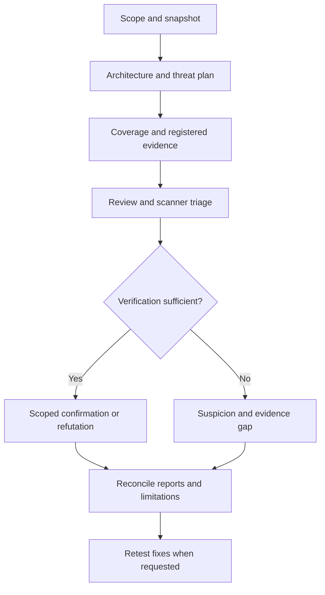

<div align="center">

# 🛡️ Software Security Audit

**Whole-project reviews for Claude Code, with traceable evidence and explicit limitations.**

[](https://github.com/ptrkdev90/security-audit-kit/actions/workflows/validate.yml)
[](LICENSE)


Architecture · Threats · Source · Dependencies · CI/CD · Evidence · HTML/PDF

[Quick start](#-quick-start) · [Updates](#-updates) · [Reports](#-reports-and-your-template) · [Workflow](#-audit-workflow) · [Development](#-development)

</div>

---

> **Release candidate:** the planned features are implemented. Stable 1.0.0 awaits
> real Claude audit behavior and an actual user-template trial. See
> [release readiness](docs/release-readiness.json). Helper tests are not detection-accuracy evidence.

## 🔍 What you get

| Capability | Result |
|---|---|
| Whole-project audit | Source, configuration, architecture, dependencies and delivery workflows |
| Threat-driven coverage | Assets, actors, abuse cases, required domains and explicit blocked checks |
| Evidence contracts | Findings linked to timestamped source/runtime/scanner/document evidence |
| Clear classification | Vulnerabilities, dependency advisories, control gaps, hardening and missing evidence |
| Architecture views | Components, trust boundaries and flows; observed/inferred/unknown statements |
| Offline reports | Matching Markdown, static HTML and optional neutral PDF from one canonical model |
| Your templates | Installed document/template skills or supplied editable files, using their export workflow |
| Resumable work | Allowlisted hashes and conservative context/scope/tool invalidation |
| Optional SOC 2 readiness | Technical, organizational and period evidence kept separate |

This plugin supplies instructions and local helpers. Scanners and rule packs are external.
Trail of Bits inspired parts of the workflow; its skills are not bundled or required.
Reports can be written in **English or German**. Nothing here certifies the audited software.

## 🚀 Quick start

### Install

```sh
claude plugin marketplace add ptrkdev90/security-audit-kit
claude plugin install security-audit@security-audit-kit
```

The public repository is [ptrkdev90/security-audit-kit](https://github.com/ptrkdev90/security-audit-kit).
Marketplace: `security-audit-kit`. Plugin: `security-audit`.

### Bare command: required start dialog

```text
/security-audit:software-security-audit
```

Before any project inspection, inventory, scanner or audit-file creation, Claude must ask:

| Decision | Choices |
|---|---|
| SOC-2-Readiness | Include it / technical audit only |
| Additional exports | None (Markdown/JSON) / HTML / PDF / HTML + PDF |
| Design | Neutral standard layout / installed template skill / supplied template file |

All three answers are required. For a custom design, supply the exact skill name or
file path. Partial replies prompt only for missing answers. Silence or dismissal never
starts an audit. The design question also applies when Markdown/JSON alone is selected.
A new bare invocation asks again; an explicit resume retains that audit's recorded choices.
An invocation with task instructions honors the choices you already supplied.

### Audit inside your project

```text
/security-audit:software-security-audit
Audit this entire software project. Map architecture and trust boundaries first.
Review source, configuration, dependencies and CI/CD. Verify findings and show gaps.
Write the report in English. Do not change application code.
Store all artifacts in a new durable directory outside tracked source.
```

German, with optional readiness and exports:

```text
/security-audit:software-security-audit
Prüfe das gesamte Projekt und erstelle den Bericht auf Deutsch.
Berücksichtige SOC-2-Readiness: technische Kontrollen, organisatorische Nachweise
und Nachweise über den Prüfzeitraum getrennt bewerten. Dokumentiere Prüflücken.
Erstelle zusätzlich HTML und ein nicht unterzeichnetes PDF mit Cover,
Zeitstempeln, geprüftem Stand und ausstehenden Review-/Freigabefeldern.
Ändere keinen Anwendungscode. Speichere die Ergebnisse dauerhaft unter
"<absoluter-neuer-Audit-Pfad>".
```

**Requirements:** Claude Code with plugin/skill support. Helpers need Python 3.10+.
Core bookkeeping and HTML use the standard library. Optional PDF needs installed
ReportLab and a suitable font; text checks need pypdf. Scanners are selected by stack.
Windows may need timezone data for IANA zones such as Europe/Berlin.
Missing tools are documented as gaps; the skill does not silently install them.

## 🔄 Updates

Before a new audit:

```sh
claude plugin marketplace update security-audit-kit
claude plugin update security-audit@security-audit-kit
claude plugin list
```

Compare the installed version with [plugin.json](plugins/security-audit/.claude-plugin/plugin.json).
Update the same scope you installed. Restart Claude Code or run `/reload-plugins` in the
current session. Updating the marketplace listing alone does not update a loaded skill.

Automatic updates: `/plugin` → **Marketplaces** → **security-audit-kit** → **Enable auto-update**.
Third-party auto-updates default to disabled. Offline access, policy or failures can leave
an older version installed. For an up-to-date audit, update manually and verify the version.
Standalone copied skills require manual replacement.
See [Claude's update documentation](https://code.claude.com/docs/en/discover-plugins#keep-plugins-updated).

## 🎨 Reports and your template

```text
Use my installed document template skill "<template-skill>" for the audit PDF.
Prepared by: <provided name>
Organization: <provided organization>
Display timezone: Europe/Berlin
Include cover, report ID/version, audit period, generated-at time, audited commit,
page numbers and unsigned review/approval fields. Keep HTML and structured evidence.
```

Alternatively supply an accessible editable template, such as DOCX, or a reference file.
No universal “Claude Design Templates” API is assumed. Template examples are presentation
data; they cannot suppress findings, invent evidence or grant permission to run macros.

| Element | Contract |
|---|---|
| Cover | Project, document ID/version, Draft/Final, snapshot, dates and confidentiality |
| Author | Supplied identity only; no inference from Git/OS/GitHub names |
| Review/signature | Pending and unsigned by default; actual signing needs explicit authorization |
| Template | Selected skill/file, version and hash when known; fidelity limitations stated |
| Output integrity | Shared findings/counts, source/output hashes, explicit limitations |
| Layout | Render and inspect every PDF page; text checks alone do not approve layout |

The built-in neutral exporter supports a declarative palette/font theme. Arbitrary DOCX
or installed template skills use their own renderer. Without a renderer, PDF is blocked
and the audit still delivers Markdown/HTML where possible. Default PDFs are not tagged
PDF/UA or certified PDF/A; specialized requirements need an appropriate exporter/checker.

A typed name or decorative signature line is not approval. A signature image is not a
cryptographic signature. Signing follows a separate authorized workflow after final export.

## 🧭 Audit workflow



A confirmed advisory proves an affected dependency, not an exploitable application flaw.
Confirmed application vulnerabilities require a full source trace or safe runtime test,
examined defenses, supported exploitability and matching registered evidence. Severity
and confidence are independent. Refutations apply only to the examined path/snapshot.
Accepted risk stays visible; a proposed fix is not `fixed` until retested.

## 🧩 Coverage

| Area | Representative review |
|---|---|
| Architecture/business logic | Trust boundaries, privileged flows, failure paths, replay/concurrency |
| Web/API | Identity/session, object/tenant authorization, injection, XSS/CSRF/SSRF and uploads |
| .NET | Policies/middleware, binding, queries, configuration and secrets |
| JS/TS/Python | Data-flow sinks, parsing, subprocesses, package hooks and framework defenses |
| Azure/IaC | Available RBAC, managed identities, storage/network exposure and deployment definitions |
| CI/CD/dependencies | Untrusted inputs, token scopes, package paths, artifacts and supply-chain controls |

Other stacks require adapted checks and honest analyzer/expertise limitations. Source,
deployed configuration and operational effectiveness are distinct evidence layers.
Unknown runtime access, unavailable scanners, stale feeds and excluded files remain visible.

## 📦 Artifacts

| File | Purpose |
|---|---|
| `scope.md`, `inventory.json` | Boundaries, snapshot, available tools and exclusions |
| `threat-model.md`, `audit-plan.json` | Assets, actors, abuse cases and mapped required checks |
| `architecture.json` | Evidence-backed boundaries, components and flows |
| `diagrams/` | Locally generated Mermaid/SVG and selected threat-flow views |
| `coverage.json`, `tool-runs.json` | Reviewed/blocked checks and actual execution outcomes |
| `evidence.json`, `findings.json` | Typed evidence and classified findings with stable IDs |
| `report-source.json`, `report-metadata.json` | Narrative, cover, audit/report versions and sign-off state |
| `export-001/` | Shared model, Markdown/HTML, optional PDF and export receipts |
| `checkpoint.md`, snapshot JSON | Progress, fingerprints and conservative resume decisions |
| `compliance-matrix.csv` | Optional readiness evidence and missing records |
| `documentation-profile.json` | Optional standards applicability and full-text/evidence status |

Store results in a fresh durable directory outside tracked source. Session temporary
folders are intermediate only. Keep private audit artifacts out of this public repository.
Redact secrets and personal data before sharing.

### Example finding

> Synthetic illustration, not a finding about this toolkit.

```yaml
id: AUD-001
kind: security-vulnerability
status: confirmed
severity: high
confidence: high
verification_basis: source-trace
exploitability: supported-by-source
location: src/OrdersController.cs:42
prerequisites: An authenticated user chooses an existing order ID.
attack_path: The handler returns an order without an owner or tenant check.
counterevidence: Middleware and query defenses were inspected.
verification_limits: Source path only; runtime and deployment untested.
evidence_ids: [E-001]
threat_ids: [TH-001]
remediation: Scope the query to the authorized owner/tenant and retest.
```

This compact example is not the full findings schema.

## 📋 SOC 2 and documentation standards

The optional matrix separates **technical**, **organizational** and **operational-over-period**
evidence. Missing records do not prove a control failed. Criterion IDs require checking
against the selected authoritative edition. Source-only review cannot attest effectiveness.
No SOC 2 attestation, ISO certification or automatic compliance score is issued.

Documentation guidance considers software-user information, architecture descriptions and
controlled English where applicable. Machinery/industrial delivery standards are selected
only when the engagement requires them. Public abstracts are not full normative reviews.
See [standards applicability](docs/STANDARDS.md) and [primary sources](docs/SOURCES.md).

## ⚙️ Helpers

Resolve `<skill-directory>` from the installed skill location:

```sh
python3 <skill-directory>/scripts/init_audit.py --output <absolute-new-audit>
python3 <skill-directory>/scripts/inventory.py --root <project> --output <audit>/inventory.json
# Populate canonical evidence, plan, architecture, narrative and metadata before exporting.
python3 <skill-directory>/scripts/validate_audit.py <audit> --final
python3 <skill-directory>/scripts/diagrams.py <audit>/architecture.json --plan <audit>/audit-plan.json --output-dir <audit>/diagrams
python3 <skill-directory>/scripts/render_report.py <audit> --output <audit>/export-001
python3 <skill-directory>/scripts/pdf_report.py <audit> --output <audit>/export-001/report.pdf
python3 <skill-directory>/scripts/check_exports.py <audit> <audit>/export-001 --pdf
```

Use `py -3` on Windows where appropriate; quote paths with spaces. Initializers/exporters
refuse overwrites. Validation checks consistency, not the truth or completeness of claims.
Target builds/tests/package hooks can execute untrusted code and follow scoped authorization.

## ♻️ Efficient review and versioning

Phase/stack references load on demand. Helpers avoid rewriting routine inventory/rendering
logic in model context. Raw scanner output remains in local artifacts for focused inspection.
Checkpoints read only permitted allowlisted files and invalidate reuse after content,
Git/context/tool changes or expiry. Cache eligibility never promotes coverage automatically.

The entry text is smaller; actual model-token savings are **unmeasured**. Paired benchmarks
track tokens alongside missed high-impact findings, false positives and coverage.
See [token methodology](docs/TOKEN-USAGE.md).

Plugin, schema, report and template versions are independent. Existing audits remain
historical artifacts. Manual migration preserves IDs/originals and does not infer a
scanner finding's exploitability. See [migrations](docs/MIGRATIONS.md).

## 🛠️ Development

```sh
python3 scripts/validate_repository.py
python3 -m unittest discover -s tests -v
python3 scripts/benchmark_context.py
```

For optional PDF tests install the reviewed versions in an isolated development environment:

```sh
python3 -m pip install -r requirements-render.txt
```

Opt-in host smoke check, with Claude Code already installed:

```sh
python3 scripts/claude_smoke.py --output <new-smoke-receipt.json>
```

It uses isolated Claude configuration, validates/installs/updates the local marketplace,
and makes no model calls. Missing Claude returns exit 77, not a pass. CI checks Python
3.10/3.12/3.13, optional PDF contracts and pinned Claude bookkeeping. Real audit behavior,
public GitHub transport, session reload and actual user templates need separate trials.

See [evaluation scenarios](docs/EVALUATION.md), [release process](docs/RELEASES.md),
[release readiness](docs/release-readiness.json) and [changelog](CHANGELOG.md).

### Standalone install

Copy `plugins/security-audit/skills/software-security-audit` into
`.claude/skills/software-security-audit` or `~/.claude/skills/software-security-audit`.
Invoke `/software-security-audit`. Update copied skills manually.

## 🤝 Contributing and security

Include evidence-driven tests, preserve uncertainty, and never claim unsupported coverage.
Use synthetic data. Report toolkit vulnerabilities through [SECURITY.md](SECURITY.md);
do not publish credentials or private audit reports in issues.

Original instructions/helpers: [MIT](LICENSE). External tools/rules keep their own licenses.
